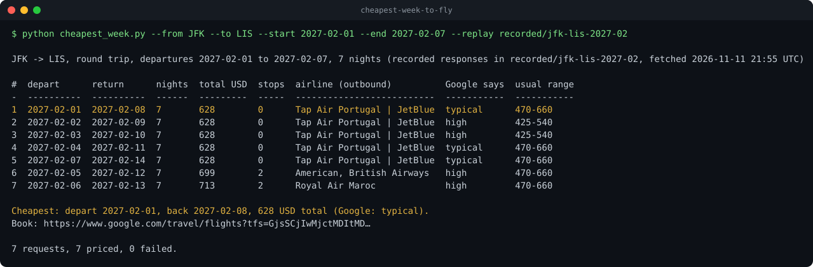

# cheapest-week-to-fly

Find the cheapest dates for a round trip. Give it a route, a range of departure dates and one or more
trip lengths; it prices every combination with live Google Flights fares and prints them ranked, with
Google's own verdict on each fare (`low` / `typical` / `high`) and the route's usual price range.

One Python file, standard library only. Writes a CSV if you want one.



## What it does

- **One request per round trip.** Each (departure date, trip length) is a single call to the
  [Google Flights Live API](https://rapidapi.com/mtnrabi/api/google-flights-live-api) round-trip endpoint.
  Both legs are priced together and come back as one total with one booking link, so there is no
  second call to fetch the return flight.
- **Google's verdict next to every price.** Each result carries `price_insights_low` /
  `price_insights_high` (Google's usual range for that route and period) and
  `price_range_in_relation_to_other_periods`, so you can see whether "cheapest" is actually a good fare.
- **Honest failures.** A search that did not complete (a 5xx) is retried once and then listed as
  "search failed, retry", never silently dropped and never shown as "no flights".

## Real example output

JFK to Lisbon, departures 2027-02-01 to 2027-02-07, 7 nights. Fetched **2026-11-11 21:55 UTC**:

```text
#  depart      return      nights  total USD  stops  airline (outbound)          Google says  usual range
-  ----------  ----------  ------  ---------  -----  --------------------------  -----------  -----------
1  2027-02-01  2027-02-08  7       628        0      Tap Air Portugal | JetBlue  typical      470-660
2  2027-02-02  2027-02-09  7       628        0      Tap Air Portugal | JetBlue  high         425-540
3  2027-02-03  2027-02-10  7       628        0      Tap Air Portugal | JetBlue  high         425-540
4  2027-02-04  2027-02-11  7       628        0      Tap Air Portugal | JetBlue  typical      470-660
5  2027-02-07  2027-02-14  7       628        0      Tap Air Portugal | JetBlue  typical      470-660
6  2027-02-05  2027-02-12  7       699        2      American, British Airways   high         470-660
7  2027-02-06  2027-02-13  7       713        2      Royal Air Maroc             high         470-660

Cheapest: depart 2027-02-01, back 2027-02-08, 628 USD total (Google: typical).

7 requests, 7 priced, 0 failed.
```

Note rows 1 and 2: the same $628 nonstop is `typical` for one week and `high` for the next, because
Google's usual range for those dates is different. Fares change within minutes; run it yourself for
current prices.

Those responses are saved in [`recorded/jfk-lis-2027-02/`](recorded/jfk-lis-2027-02), so you can try
the tool before you have a key:

```bash
python cheapest_week.py --from JFK --to LIS --start 2027-02-01 --end 2027-02-07 --replay recorded/jfk-lis-2027-02
```

## Quick start (2 minutes)

1. **Get a key.** Open the [Google Flights Live API on RapidAPI](https://rapidapi.com/mtnrabi/api/google-flights-live-api),
   sign up and subscribe to the free **BASIC** plan (a small monthly request quota, no card). Copy your
   `X-RapidAPI-Key`.
2. **Run it.**

   ```bash
   git clone https://github.com/mtnrabi/cheapest-week-to-fly
   cd cheapest-week-to-fly
   export RAPIDAPI_KEY=your-key-here
   python cheapest_week.py --from JFK --to LIS --start 2027-02-01 --end 2027-02-07 --nights 7
   ```

That is 7 requests. Python 3.9+ and nothing to install.

## Bigger scans

```bash
# a whole month at three trip lengths = 31 x 3 = 93 requests
python cheapest_week.py --from LHR --to JFK --start 2027-05-01 --end 2027-05-31 --nights 5,7,10 --top 15 --csv may.csv

# nonstop only, prices in euros
python cheapest_week.py --from BER --to LIS --start 2027-04-01 --end 2027-04-14 --nights 4 --max-stops 0 --currency eur
```

Every (date, trip length) is one request, and the tool tells you the count before a scan over 20
requests (`--yes` skips the question). The free BASIC plan covers a few small scans; for regular month-wide
scans, **PRO is $10 a month for 2,500 requests** (about 26 of the 93-request month scans above).

| Option | Meaning |
|---|---|
| `--from`, `--to` | IATA airport codes |
| `--start`, `--end` | first and last departure date (YYYY-MM-DD) |
| `--nights` | trip length(s): `7` or `5,7,10` (default 7) |
| `--currency` | e.g. `usd`, `eur`, `gbp` (default `usd`) |
| `--max-stops` | max stops on each leg; `0` = nonstop |
| `--top N` | show only the N cheapest |
| `--csv FILE` | write every result (with booking links and fetch time) to a CSV |
| `--workers N` | parallel requests (default 4) |
| `--replay DIR` | answer from saved responses instead of the API |

## The request it sends

```bash
curl -X POST https://google-flights-live-api.p.rapidapi.com/api/google_flights/roundtrip/v1 \
  -H "Content-Type: application/json" \
  -H "x-rapidapi-host: google-flights-live-api.p.rapidapi.com" \
  -H "x-rapidapi-key: $RAPIDAPI_KEY" \
  -d '{"from_airport":"JFK","to_airport":"LIS","departure_date":"2027-02-01","return_date":"2027-02-08","currency":"usd","limit":10}'
```

There is no `sort_type` on purpose. Google gives no usual range and no verdict on a price-sorted page, so with
`"sort_type":"Price"` (or `max_price`) the last two columns would be empty. The tool takes the cheapest row itself.
Rows come back with the fewest stops first and are cut at `limit`, so a trip with many stops can be cheaper than
the one shown. If you only want the lowest number and no verdict, add `"sort_type":"Price"` in `build_body`.

The answer is a JSON array of itineraries; each has `total_price_as_number`, both legs' airline,
stops and times, `buy_link`, and Google's range fields. Field reference: the
[API listing](https://rapidapi.com/mtnrabi/api/google-flights-live-api) and
[api.flightpowers.com/docs](https://api.flightpowers.com/docs).

The script also sends `_fp_source` / `_fp_tool` in the body so FlightPowers can count requests that
come from this example. The API removes them before reading the search; delete them from
`ATTRIBUTION` in the script if you prefer.

## Tests

```bash
pip install pytest
pytest -q
```

The tests run on the recorded responses, no key needed.

## Related

- [flight-price-alert-bot](https://github.com/mtnrabi/flight-price-alert-bot): a Telegram / Discord bot that
  watches routes and pings you when a fare drops.
- [n8n-flight-fare-watch](https://github.com/mtnrabi/n8n-flight-fare-watch): a daily fare watch as an n8n
  workflow or a GitHub Action.
- [FlightPowers](https://flightpowers.com): the API behind these examples, also as an MCP server for Claude,
  Cursor and ChatGPT.

Not affiliated with Google. MIT licensed.
